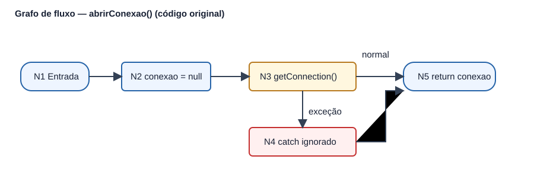
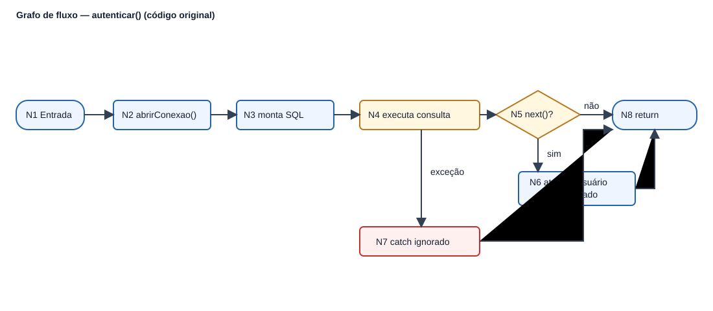

# Atividade — teste de caixa branca e revisão de código-fonte

## 1. Cenário e objetivo

Este repositório trata o cenário 1, autenticação JDBC. O objetivo é avaliar o código-base legado, modelar seu fluxo de controle, definir testes de caixa branca e entregar uma alternativa revisada. A cópia em `original/` foi preservada literalmente; nenhuma credencial real é publicada.

## 2. Como executar

Requisito: JDK 17 ou superior (a versão revisada usa `record`). No PowerShell, a partir da raiz do projeto:

```powershell
.\testes\executar-testes.ps1
```

Os testes usam um repositório falso em memória. Portanto, não exigem MySQL, rede nem credenciais. A classe `RepositorioUsuariosJdbc` é a adaptação JDBC para uso posterior com um `DataSource` configurado fora do código.

## 3. Análise estática do original

A planilha `PLANO_DE_TESTE.xlsx`, na aba **CAIXA BRANCO (ESTÁTICO)**, contém o registro detalhado. Principais achados:

| Local | Ocorrência e risco | Severidade | Recomendação |
|---|---|---:|---|
| `abrirConexao`, linha 13 | URL contém usuário `root` e senha em texto claro. Vaza segredo em Git/logs e usa conta privilegiada. | Crítica | Configuração externa, segredo gerenciado e usuário com privilégio mínimo. |
| `autenticar`, linhas 22–23 | Concatenação de `usuario` e `senha` na SQL permite injeção SQL, por exemplo `x' OR '1'='1`. | Crítica | `PreparedStatement` com parâmetros. |
| ambos os `catch`, linhas 15–17 e 31–33 | Capturas de `Exception` silenciosas ocultam falhas. | Alta | Capturar tipos específicos, registrar e propagar/retornar erro explícito. |
| `autenticar`, linhas 25–26 | `Connection`, `Statement` e `ResultSet` não são fechados. | Alta | `try-with-resources`. |
| `autenticar`, linha 20 | Se a conexão falhar, `conexao` é `null`; o `NullPointerException` é engolido e o método devolve estado possivelmente antigo. | Alta | Não retornar `null` silenciosamente; propagar falha técnica. |
| atributo `autenticado`, linhas 8 e 34 | Estado persiste entre chamadas: depois de um sucesso, uma tentativa inválida pode retornar `true`. Não é seguro para reuso concorrente. | Alta | Resultado imutável por chamada, sem estado de sessão no serviço. |
| `autenticar`, linhas 20–34 | Não valida `null`, vazio ou espaços; também mistura autenticação, SQL e estado da sessão. | Média | Validar entradas e separar repositório de serviço. |
| classe e métodos | Há pouca documentação, nomenclatura sem acento de contexto e dependência direta estática de JDBC, dificultando teste. | Média | JavaDoc essencial, injeção de dependência e responsabilidades menores. |

## 4. Grafos de fluxo de controle do código original

Convenção: cada método tem um componente (`P = 1`). Um bloco sequencial é um nó; a operação JDBC dentro de `try` é um nó que pode seguir normalmente ou desviar para `catch`; `return` é nó de saída. Exceções modeladas: qualquer `Exception` levantada pela obtenção de conexão em `abrirConexao`, e exceções de conexão nula, criação de `Statement`, execução da consulta e leitura do resultado em `autenticar`.

Os arquivos-fonte dos diagramas estão em `diagramas/*.puml` e podem ser abertos no PlantUML.

### `abrirConexao()`



Nós: N1 entrada; N2 inicialização com `null`; N3 chamada `getConnection`; N4 `catch`; N5 `return`.

| Arestas | N | E | P | V(G) |
|---|---:|---:|---:|---:|
| 1→2, 2→3, 3→5, 3→4, 4→5 | 5 | 5 | 1 | **2** |

`V(G) = E - N + 2P = 5 - 5 + 2 = 2`. Há duas regiões (incluindo a externa). Como não há decisão explícita, a bifurcação excepcional é a convenção que adiciona um caminho independente.

Caminhos básicos independentes:

1. **AC1:** N1 → N2 → N3 → N5 — conexão criada.
2. **AC2:** N1 → N2 → N3 → N4 → N5 — `getConnection` lança exceção e o legado retorna `null`.

### `autenticar(String, String)`



Nós: N1 entrada; N2 abre conexão; N3 monta SQL; N4 cria `Statement`/executa SQL; N5 decisão `resultado.next()`; N6 atualiza atributos; N7 `catch`; N8 retorno.

| Arestas | N | E | P | V(G) |
|---|---:|---:|---:|---:|
| 1→2, 2→3, 3→4, 4→5, 4→7, 5→6, 5→8, 6→8, 7→8 | 8 | 9 | 1 | **3** |

`V(G) = 9 - 8 + 2 = 3`. Checagem: uma decisão explícita (`next`) e uma bifurcação excepcional modelada, logo `1 + 2 = 3` caminhos básicos/regiões.

Caminhos básicos independentes:

1. **AU1:** N1 → N2 → N3 → N4 → N5 (verdadeiro) → N6 → N8 — usuário encontrado.
2. **AU2:** N1 → N2 → N3 → N4 → N5 (falso) → N8 — consulta sem linha.
3. **AU3:** N1 → N2 → N3 → N4 → N7 → N8 — falha de JDBC ou `NullPointerException` capturada silenciosamente.

`N2` pode invocar o caminho AC1 ou AC2. Essa interação é planejada nos testes, mas o grafo de cada método foi mantido separado conforme o enunciado.

## 5. Matriz de testes e resultados

| ID | Método/versão | Caminho | Entrada e pré-condição | Esperado | Observado | Situação/evidência |
|---|---|---|---|---|---|---|
| T01 | revisado `autenticar` | sucesso | `ana`/`segredo`; falso contém Ana | autenticado e nome `Ana Silva` | conforme esperado | Passou; saída do script |
| T02 | revisado `autenticar` | falha normal | `ana`/`errada`; falso contém somente a senha válida | resultado falso, sem nome | conforme esperado | Passou; saída do script |
| T03 | revisado `autenticar` | validação | usuário composto só de espaço | `IllegalArgumentException` | conforme esperado | Passou; saída do script |
| T04 | revisado `autenticar` | validação | senha `null` | `IllegalArgumentException` | conforme esperado | Passou; saída do script |
| T05 | revisado `autenticar` | erro externo | repositório falso lança exceção | `FalhaAutenticacaoException` com causa | conforme esperado | Passou; saída do script |
| T06 | legado `abrirConexao` | AC2 | Driver MySQL ausente | `null` sem diagnóstico | retornou `null` | Passou; `AutenticacaoLegadaTest` |
| T07 | legado `autenticar` | AU3 | conexão nula após AC2 | erro engolido e retorno `false` | retornou `false` sem lançar erro | Passou; `AutenticacaoLegadaTest` |
| T08 | legado `autenticar` | AU2 com entrada hostil | driver JDBC falso captura a consulta; usuário `x' OR '1'='1` | SQL concatenada contendo a carga hostil | consulta capturada contém a carga hostil | Passou; `AutenticacaoLegadaTest` |

Para induzir caminhos JDBC reais sem depender de infraestrutura externa, os testes do legado usam um driver JDBC falso que captura a SQL e proxies para os objetos JDBC. Os testes da versão revisada usam um falso de `RepositorioUsuarios`, que testa a regra de negócio e as condições de erro de forma repetível. A implementação JDBC está isolada para teste de integração futuro.

## 6. Correções implementadas

A versão revisada substitui o estado mutável por `ResultadoAutenticacao`, valida credenciais antes da consulta, recebe o repositório por injeção de dependência e diferencia credencial inválida de falha técnica. `RepositorioUsuariosJdbc` usa parâmetros em `PreparedStatement` e fecha `Connection`, `PreparedStatement` e `ResultSet` com `try-with-resources`.

| Aspecto | Original | Revisado |
|---|---|---|
| Segurança | segredo no fonte e SQL concatenada | configuração externa e parâmetros JDBC |
| Confiabilidade | exceções silenciosas e `null` implícito | exceção de domínio com causa preservada |
| Recursos | vazamento potencial | fechamento determinístico |
| Estado | `autenticado` e usuário persistem | resultado imutável por chamada |
| Testabilidade | JDBC estático acoplado | porta `RepositorioUsuarios` substituível |

A complexidade do revisado não foi mantida deliberadamente: sua estrutura e responsabilidades são diferentes. O cálculo obrigatório desta atividade é o da versão original, apresentado acima.

## 7. Limitações

Não há servidor MySQL nem credenciais reais no repositório, logo a implementação JDBC não foi exercitada contra banco. Senhas devem ser armazenadas como hashes fortes com sal (por exemplo, Argon2id ou bcrypt); esta atividade preserva a coluna `senha` apenas para evidenciar o legado e o contrato mínimo.

## 8. Conclusão

O legado concentra vulnerabilidades críticas de segredo exposto e injeção SQL, além de ocultar erros e manter estado indevido. A revisão isola a infraestrutura, elimina a concatenação SQL, fecha recursos e oferece testes reproduzíveis para os caminhos mais relevantes.
